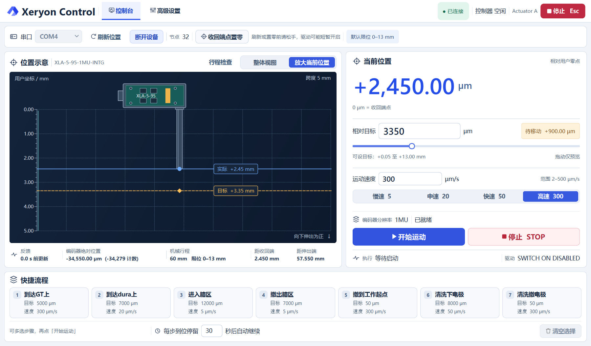

# Xeryon Control · 电极推进器控制台

基于 Xeryon CANopen 示例扩展的 Python / PySide6 Qt Widgets 桌面控制软件，用于 XLA 推进器控制、状态观察和问题复现。

**历史发布版本 20261106.38 为诊断版，待实机验收。** 已知长行程停滞、过冲、启停位置变化仍待解决。离线测试通过不代表这些实机问题已经修复；详见 [历史已知问题](docs/history/KNOWN_ISSUES.md)。

[开发与调试](docs/DEVELOPMENT.md)　[贡献指南](docs/CONTRIBUTING.md)　[厂家手册](docs/reference/xeryon-intg-manual-v13.pdf)　[厂家对象字典](docs/reference/xeryon_xla_5_eds_docu.txt)　[历史验证记录](docs/history/VALIDATION.md)

## 当前源码的零点与分段进退

驱动失能时，把推杆放在实物收回端点，松手并待其静止，再点「收回端点置零」。软件短暂使能当前轴，保持 Halt 且不触发新运动目标，读取编码器后失能。使能期间和失能停稳后的读数一致（允许 1 计数误差）才记录用户零点。过程中可按 STOP 取消。单轴绝对目标和分段坐标以此处为 0 µm。

置零后再次手调推杆，部分固件可能直到下次使能才报告新位置。控制台「开始运动」检测到起点变化超过约 20 µm 时，会先停止并核验失能。弹窗列出新起点、原目标、带方向的剩余位移和速度。点「继续」会再次读取位置、校验目标与限位，并按新的实际起点运动；点「取消」会同时取消排队的快捷步骤。

未连接时，「刷新串口」重新列出可用端口。连接后，「刷新位置」读取当前轴。请先松手：若驱动已关闭，会短暂在 Halt 下开启，读取编码器，再关闭并确认停稳；驱动已开启时直接读取。刷新保留用户零点和目标。

切换轴会恢复该轴本次连接的标定，双轴联动使用已确认的联动零点并逐轴检查机械行程。断开连接会结束本次标定，控制器重启或重新找参考点后须重新核对机械零点。通信异常会中止流程；恢复反馈后点击「复核零点」，程序核对各节点身份、故障前位置和失能后的稳定位置。复核通过后由操作者重新发起运动。

在「高级设置 → 高级控制」填写工作起点、快慢切换点和推进终点。默认分别为 50、10050、13000 µm。坐标顺序决定推进方向。页面显示从当前位置推进或退出的下一段。STOP 后可从已确认的位置继续，例如在 11000 µm 点击分段推进只执行到 13000 µm 的慢速段。退出时先慢速越过切换点，确认所有参与轴已离开切换窗口后才加速。流程范围外会拦截，已在对应终点窗口内无需运动。

这些变更尚待实机验收。下图来自当前 PySide6 应用，使用模拟反馈演示界面。

## 控制台



[高级设置界面](docs/images/xeryon-control-settings.png)

[历史 Windows 诊断版 20261106.38](https://github.com/Baoqi-pku2/xeryon-control/releases/tag/v20261106.38)。

## 运行

Windows 可双击根目录的 `run.cmd` 启动。脚本通过 uv 启动项目。也可从终端运行。uv 按 `.python-version` 选择基础解释器，在 `.venv` 中安装锁定依赖。Windows 下应用使用 `.venv\Scripts\python.exe`。

```powershell
uv run python -m xeryon_control
```

环境已同步时，也可直接运行 `.\.venv\Scripts\python.exe -m xeryon_control`。

界面会自动保存手动修改的连接参数、运动参数、分段流程、快捷停留时间和测试设置。源码版和 Windows EXE 共用 `%LOCALAPPDATA%\XeryonControl\settings.ini`。下次启动会恢复表单值；应用到设备仍通过原有连接和操作流程完成。用户零点、行程确认、待执行目标和快捷队列仅在当前会话有效。

主窗口按当前显示器的可用区域居中。宽屏双栏显示位置与运动，窄屏顺序排列并可滚动；顶部停止按钮始终可达。

连接前核对实际串口、CAN 波特率、节点和编码器型号。源码默认 `slcan / COM3 / 125 kbit/s / Node 32 / ENC_RES_1MU`，主推进器使用厂家默认节点 32。不要将软件显示的默认行程视为已测得的机械端点。配置入口及常见故障见 [开发与调试](docs/DEVELOPMENT.md)。

## 离线测试

从项目根目录运行，不需要 CAN 设备：

```powershell
uv run --locked python -m unittest discover -s tests -p "test_*.py" -v
uv run --locked python tools/verify_ui_layout.py --output layout-check.json
uv run --locked python tools/verify_ui_responsiveness.py --output responsiveness-check.json
```

Qt 测试默认使用离屏平台，桌面上也可直接启动 EXE。GitHub Actions 配置为 Windows 上执行离线单元测试，不执行硬件诊断或运动。手动脚本 `examples/tests/verify_communication.py` 不属于这组离线测试。

## Windows 打包

双击 `build_portable.cmd` 会同步打包依赖、生成 EXE 并核对包内源码。手动打包可从项目根目录执行，生成 `release/portable/XeryonControl.exe`。

```powershell
uv run --group build python -m PyInstaller --noconfirm --distpath release/portable --workpath build/portable XeryonControl.spec
```

本地路径、Python 发行版和打包依赖可能影响二进制哈希；重新打包后需重新检查，不能沿用历史 EXE 的验证结论。

## 协作

欢迎通过 [Issues](https://github.com/Baoqi-pku2/xeryon-control/issues) 报告复现过程，通过分支和 Pull Request 提交修改。请先读 [CONTRIBUTING.md](docs/CONTRIBUTING.md)。直接写入仓库需要维护者邀请；公开可见不等于任何人都能直接修改主分支。

| 路径 | 内容 |
| --- | --- |
| `src/xeryon_control/ui/main_window.py` | Qt 主窗口与界面事件 |
| `src/xeryon_control/ui/position_panel.py`, `src/xeryon_control/ui/theme.py` | 紧凑控制面板与界面样式 |
| `src/xeryon_control/hardware/` | CANopen 参数与底层工具 |
| `tests/test_*.py` | 离线回归测试 |
| `tools/verify_ui_*.py` | 离线布局和响应检查 |
| `tools/run_hardware_validation.py` | 设备诊断脚本，运行前必须审阅实际动作和参数 |
| `src/xeryon_control/resources/eds/` | 厂家设备描述 |

`configuration.py`、`homing.py`、节点配置和硬件诊断脚本可能改变设备状态或参数，不是快速入门命令。调试从离线测试开始，涉及真实运动的修改须单独安排实机验证。

## 来源与声明

上游：[Xeryon-Precision/XLA-INTG_prog_examples](https://github.com/Xeryon-Precision/XLA-INTG_prog_examples)。接线及厂家使用说明请查阅上游文档和官方手册。本项目保留 [NOTICE.txt](docs/NOTICE.txt) 及源码中的厂家声明；未将上游代码重新授予 MIT/Apache 等许可证。仓库公开用于查看与协作，不应据此推断获得额外的再许可权利。

本仓库只收录当前源码和协作资料，不包含本地虚拟环境、旧版 EXE、实验原始数据或完整历史诊断记录。该历史诊断版的验证范围见 [版本说明](docs/history/RELEASE_20261106_38.md)。
