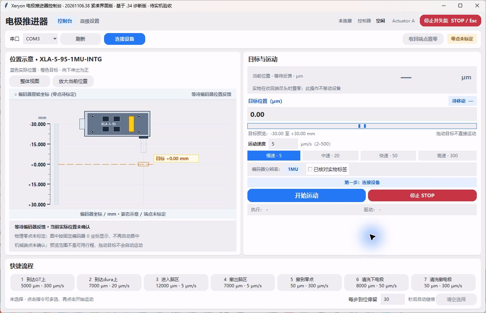

# Xeryon Control · 电极推进器控制台

基于 Xeryon CANopen 示例扩展的 Python / Tkinter 桌面控制软件，用于 XLA 推进器控制、状态观察和问题复现。

**当前版本：20261106.38，诊断版，待实机验收。** 已知长行程停滞、过冲、启停位置变化仍待解决。离线测试通过不代表这些实机问题已经修复；详见 [已知问题](docs/KNOWN_ISSUES.md)。

## 最新版界面



20261106.38 实际程序截图（未连接设备）。[下载 Windows 诊断版](https://github.com/Baoqi-pku2/xeryon-control/releases/tag/v20261106.38)。

## 运行

Windows 建议使用 Python 3.13（含 Tcl/Tk）。首次运行双击 `run_gui.cmd`，脚本会创建本地环境、安装依赖并打开界面；打开界面不会自动连接设备。

也可在项目根目录执行：

```powershell
py -3.13 -m venv .xeryon-venv
.\.xeryon-venv\Scripts\python.exe -m pip install -r requirements-dev.txt
.\.xeryon-venv\Scripts\python.exe examples/control_gui.py
```

本版采用紧凑双栏，顶部标题、导航、状态、STOP 同排；默认 1320×820，最小 1100×760。主页面和高级设置不做纵向滚动，日志与结果表保留内部滚动。

连接前核对实际串口、CAN 波特率、节点和编码器型号。源码默认 `slcan / COM3 / 125 kbit/s / Node 33 / ENC_RES_1MU`，这些是已有设备的配置，不适用于所有设备；厂家默认节点为 32。不要将软件显示的默认行程视为已测得的机械端点。配置入口及常见故障见 [开发与调试](docs/DEVELOPMENT.md)。

## 离线测试

从项目根目录运行，不需要 CAN 设备：

```powershell
.\.xeryon-venv\Scripts\python.exe -m unittest discover -s examples/tests -p "test_*.py" -v
.\.xeryon-venv\Scripts\python.exe tools/verify_ui_layout.py --output layout-check.json
.\.xeryon-venv\Scripts\python.exe tools/verify_ui_responsiveness.py --output responsiveness-check.json
```

GUI 测试需要可用的桌面和 Tk。GitHub Actions 配置为 Windows 上执行离线单元测试，不执行硬件诊断或运动。手动脚本 `examples/tests/verify_communication.py` 不属于这组离线测试。

## Windows 打包

完成环境安装后双击 `build_portable.cmd`，输出为 `release/portable/XeryonControl.exe`。也可执行：

```powershell
.\.xeryon-venv\Scripts\python.exe -m pip install -r requirements-build.txt
.\.xeryon-venv\Scripts\python.exe -m PyInstaller --noconfirm XeryonControl.spec
```

第二种方式输出到 `dist/XeryonControl.exe`。本地路径、Python 发行版和打包依赖可能影响二进制哈希；重新打包后需重新检查，不能沿用历史 EXE 的验证结论。

## 协作

欢迎通过 [Issues](https://github.com/Baoqi-pku2/xeryon-control/issues) 报告复现过程，通过分支和 Pull Request 提交修改。请先读 [CONTRIBUTING.md](CONTRIBUTING.md)。直接写入仓库需要维护者邀请；公开可见不等于任何人都能直接修改主分支。

| 路径 | 内容 |
| --- | --- |
| `examples/control_gui.py` | GUI 与控制流程 |
| `examples/position_panel.py`, `examples/ui_theme.py` | 紧凑控制面板与界面样式 |
| `examples/common/` | CANopen 参数与底层工具 |
| `examples/tests/test_*.py` | 离线回归测试 |
| `tools/verify_ui_*.py` | 离线布局和响应检查 |
| `tools/diagnose_*.py`, `tools/run_hardware_validation.py` | 设备诊断脚本，运行前必须审阅实际动作和参数 |
| `eds/` | 厂家设备描述 |

`configuration.py`、`homing.py`、节点配置和硬件诊断脚本可能改变设备状态或参数，不是快速入门命令。调试从离线测试开始，涉及真实运动的修改须单独安排实机验证。

## 来源与声明

上游：[Xeryon-Precision/XLA-INTG_prog_examples](https://github.com/Xeryon-Precision/XLA-INTG_prog_examples)。接线及厂家使用说明请查阅上游文档和官方手册。本项目保留 [NOTICE.txt](NOTICE.txt) 及源码中的厂家声明；未将上游代码重新授予 MIT/Apache 等许可证。仓库公开用于查看与协作，不应据此推断获得额外的再许可权利。

本仓库只收录当前源码和协作资料，不包含本地虚拟环境、旧版 EXE、实验原始数据或完整历史诊断记录。当前验证范围见 [版本说明](docs/RELEASE_20261106_38.md)。
